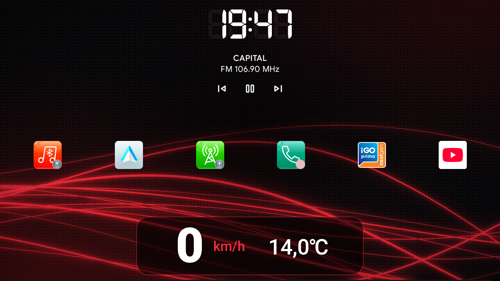
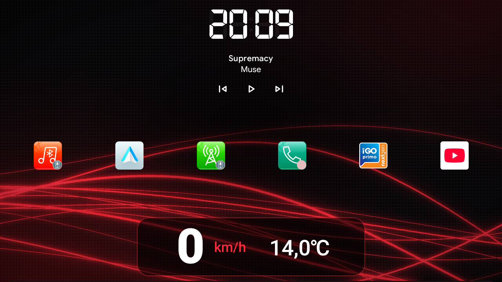

# Android car radio tweaks

Notes, a debloat list and a small companion app for the cheap Chinese Android head units that run the
**TS / forfan firmware**: the ones whose radio, Bluetooth, CAN bus and settings all live in one system app,
`com.ts.MainUI`.

The firmware hides the status bar for every app except its own, so a third-party launcher loses the outside
temperature, and the stock launcher's "now playing" box goes away with it. The companion app brings both back
to any launcher.

| Radio as the source | Bluetooth music as the source |
|---|---|
|  |  |

*Kvaesitso launcher with the companion app: media card at the top, speed and outside temperature at the bottom.*

## Does this fit my radio?

Check over ADB:

```sh
adb shell pm list packages com.ts.MainUI        # must print package:com.ts.MainUI
adb shell getprop | grep forfan                 # forfan.* properties: same firmware family
```

Units tested so far are in [`radios/`](radios/). Yours not there? See [CONTRIBUTING.md](CONTRIBUTING.md).

## The companion app

One small app (package `it.radio.velocita`, no internet permission, no Gradle) that does three things:

- **Speed and outside temperature widget.** The speed comes from MainUI (GPS), the temperature from the
  car's CAN bus: the same text the hidden status bar would show. No internet, no weather service.
- **Bluetooth music in any launcher.** The firmware's Bluetooth player has a media session that never
  turns active and posts no notification, so launchers don't see it. The app mirrors it into a normal media
  session with play/pause and skip.
- **Radio station in any launcher.** When the FM/AM radio is the active source, the same media card shows the
  RDS station name and the frequency, as the stock launcher did. Previous/next tune to the previous/next
  station. Play/pause does nothing on the radio: it has no pause.

### Install

1. Get ADB over Wi-Fi working. On many of these units ADB listens on port 5555 with no authorization:
   `adb connect <radio-ip>:5555`.
2. Download the APK from [Releases](../../releases) and install it:
   ```sh
   adb install -r android-car-radio-tweaks-1.7.apk
   ```
3. Let it run in the background without a notification icon. It is a notification listener only to stay alive;
   it does not read your notifications:
   ```sh
   adb shell cmd notification allow_listener it.radio.velocita/it.radio.velocita.SpeedService
   ```
4. Add the **Speed** widget to the home screen.
5. Kvaesitso only: in the media widget settings, under the media players it may control, tick **BT Music**.
   After reinstalling the app, force-stop the launcher once so it drops the old media session.

### Build

JDK 17 and an Android SDK with build-tools 36.1.0 and platform 36:

```sh
JAVA_HOME=/path/to/jdk-17 ANDROID_HOME=~/Android/Sdk app/build.sh
```

The script runs a few self-checks, then signs with `KEYSTORE` (default: a new `app/key.jks`). An APK signed
with your own key cannot update the release APK in place: uninstall first.

## Head unit quirks worth knowing

- **Fullscreen is forced.** The firmware hides the status bar for every non-system app, launcher included.
  It cannot be turned off without root; the widget above is the workaround.
- **Car apps are hidden from other launchers.** Radio, BT music and the rest use the custom category
  `MYLAUNCHER`, so other launchers don't list them. Create shortcuts with
  [Activity Launcher](https://github.com/butzist/ActivityLauncher), or for BT music use the app's
  own **BT Music** icon.
- **No battery voltage.** The Fiat/Alfa CAN protocols in MainUI carry none and the MCU exposes none. Use an OBD
  dongle (e.g. Torque) for that.
- **Settings.** The car settings (MainUI) are separate from Android's settings. The factory menu and its codes
  are in [docs/mainui.md](docs/mainui.md#factory-menu). Read the warning there before you type anything.

## Debloat

Each unit in [`radios/`](radios/) has a `debloat.txt`: packages that were disabled and lived with. Disable,
never uninstall:

```sh
grep -v '^#' radios/<unit>/debloat.txt | cut -d'#' -f1 | xargs -n1 adb shell pm disable-user --user 0
```

Undo one: `adb shell pm enable <package>`.

## For developers

[docs/mainui.md](docs/mainui.md) documents the MainUI binder interface (speed, radio, keys, work mode), the
system property with the outside temperature and the factory menu, all from MainUI 1.0.75.

## Related projects

Other open-source work on the same firmware family:

- [OpenRadioFM](https://github.com/kapi21/OpenRadioFM): a full FM radio app (RDS, station logos, widget) for
  several head unit platforms, including MTK8259_8667; it talks to the same MainUI radio interface.
- [Radio+](https://github.com/edman01/radio-plus-open): an FM/AM radio app tested on the Junsun V7, with
  experimental MainUI support.
- [ev-range-headunit](https://github.com/zsabbasi/ev-range-headunit): reads CAN data through MainUI to show the
  real range of a small EV.

## Disclaimer

Unofficial and not affiliated with any manufacturer. You change your own head unit at your own risk.
